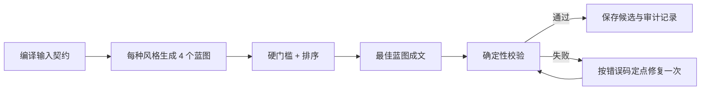

# Mnemonic Story Prompt Framework — MSF-2.1 Prompt Policy

状态（2026-10-22）：**八个模板已更新；核心 Prompt 策略已适配 Unity 运行时；完整四候选/独立 Audit 管线尚未接入。** Unity 使用 `MnemonicStoryPrompts.cs` 构造请求，并不在运行时读取本目录。它仍执行一次规划、一次成文与至多一次修复，保留现有 JSON、模型参数和 160–210 词预算。下文的四蓝图、profile、独立审计和扩展输出是完整框架设计，不应当作当前运行时能力。

Prompt 内容版本：`MSF-2.1`。本目录三个 Schema 的序列化版本仍为 `MSF-2.0`，占位符 `{{FRAMEWORK_VERSION}}` 必须继续展开为 `MSF-2.0`；Unity 的最简输出本来就没有此字段。详见 `PROMPT_ONLY_CHANGES.md`。

## 1. 目标

本框架不是让模型“写一篇包含所有单词的故事”，而是把生成过程定义为一个可检查、可复现的助记故事编译流程。最终故事要形成这条回忆路径：

`西班牙语词形 → 英文词义 → 独特动作/结果 → 下一事件 → 之后绑定到空间锚点`

核心质量标准：

1. **覆盖准确**：每个目标词恰好出现一次，词形和释义不得改写。
2. **词义优先**：先按实际词义设计事件，动词、状态与抽象概念不必成为物理工具；自然英文语法不能被目标标签破坏。
3. **词形—词义—事件绑定**：精确短语与体现词义的动作、状态或结果出现在同一句，每个词具有一个可区分的主要线索。
4. **故事连续**：上一拍通过未解决的问题、可感知变化、动作延续或情境变化自然引出下一拍，而非机械工具链或物品清单。
5. **语言易读**：使用第二人称、具体动词、短句和常用英文。
6. **实验变量干净**：不添加实验家具绑定、房间布局、导航路线或记忆术说明；普通场景和目标词本身涉及的概念仍允许，空间绑定由后续流程完成。
7. **可复现**：Prompt、Schema、候选风格、模型参数和验证结果都可记录版本。

## 2. 设计依据

- [LensWord](https://github.com/conectlens/lensword) 把词汇、用户助记内容和 2D memory palace 分开，并在 AI 请求中使用指令/数据隔离、边界标记、长度限制和输出限制。本框架沿用“模型指令不可与词汇数据混写”的工程原则。
- [vocab](https://github.com/AndrewMeleka/vocab) 证明“短篇、全部覆盖、突出目标词”的微故事形式足够轻量，但单次自由生成缺少候选选择、因果验证和定点修复。
- [PAIR Wordcraft](https://github.com/PAIR-code/wordcraft) 将上下文示例、操作类型、模型调用和解析分层。本框架同样把稳定规则、任务数据、few-shot 示例和输出 Schema 拆开版本化。
- Lee、McNichols、Lan 的 [Overgenerate-and-Rank](https://arxiv.org/abs/2409.13952) 工作表明，助记线索更适合先过生成再排序；评价至少应关注可成像性、连贯性、词序、语境完整度和语言难度。
- 学习者中心的 [WordCraft 研究](https://arxiv.org/abs/2602.00762) 强调生成效应、相关关键词、结构化关联、视觉形成与可回忆路径。由于本项目是受控实验，v2 先强化“动作—结果—因果链”，不默认加入发音双关，以免引入新的实验混杂变量。
- [llguidance](https://github.com/guidance-ai/llguidance) 展示了 JSON Schema / grammar constrained decoding 的可行性。支持约束解码的后端应直接使用 Schema；其他后端则走严格 JSON、解析器和一次定点修复。

## 3. 总体流程

### 3.1 外层候选

参与者看到的三个候选应来自固定而不同的叙事 profile，而不是连续三次无约束采样：

| Profile | 设计意图 | 边界 |
|---|---|---|
| `collaborative_rescue` | 与一个同伴解决轻度紧迫、日常且安全的问题 | 不使用灾难、伤亡或惊吓 |
| `hands_on_repair` | 通过修理、搭建或恢复功能形成强动作链 | 避免技术术语和复杂机械细节 |
| `gentle_mystery` | 沿可见线索寻找误放的重要物品 | 不使用犯罪、威胁或恐怖元素 |

每个 profile 内先生成 4 个结构化蓝图，筛选后只渲染 1 个故事。这样三个 UI 候选的差异来自可记录的实验条件，而不是不可解释的随机漂移。

### 3.2 为什么暂不默认加入 phonetic keyword

公开的 keyword-mnemonic 研究证明了发音相近词的价值，但当前实验同时使用目标词、英文释义、故事顺序和空间锚点。强制加入发音双关会增加一条记忆路径，也可能带来语言背景差异。v2 因而默认采用：

`目标词 → 释义 → 具体动作/结果`

以后若要研究 phonetic keyword，应以 `phonetic_bridge_enabled` 实验开关建立独立条件，并记录生成词、相似度和人工审核结果，而不是悄悄混入当前故事。

## 4. Prompt 分层

所有模型调用由四层组成：

1. **System contract**：稳定角色、不可违反的原则、禁止泄露推理过程。
2. **Task contract**：profile、目标数量、长度和语言等级等本次参数。
3. **Untrusted data block**：目标词 JSON、蓝图或待修复故事，使用带 request id 的边界包裹。
4. **Output schema**：由 API 的 structured output / constrained decoding 提供；若后端不支持，则附在 user prompt 末尾并本地验证。

不得把词汇、释义或参与者输入拼接到 system message。数据块内出现的任何“指令”都只被视作数据。

进入 Prompt 前先执行统一规范化：字符串使用 Unicode NFC、去掉首尾空白和控制/零宽字符；拒绝空值、重复规范词形、换行、圆括号以及边界标记片段；限制 `word` 为 1–80 字符、`meaning` 为 1–160 字符。目标列表必须由 JSON serializer 生成，不能手工拼接。每次请求使用不可预测的 request id 形成独立边界，并把规范化前后的值写入审计记录。

## 5. 阶段 A：蓝图过生成

模板：

- `prompts/planner.system.txt`
- `prompts/planner.user.template.txt`
- `schemas/plan.schema.json`

每个 beat 都包含：

- `word` / `meaning`：原始目标，不得改写。
- `role`：该词在因果链中的功能。
- `entryCue`：为什么此刻需要它。
- `action`：准确体现词义的动作、体验、状态变化或决定。
- `visibleResult`：可感知或容易理解的后果；抽象概念可以通过行为和后果体现。
- `nextNeed`：结果创造出的下一需求；最后一拍固定为 `GOAL_RESOLVED`。
- `imageTag`：该词唯一的视觉签名，供干扰检查使用。

为了让连接字段可机械检查，`beat[i].nextNeed` 必须与 `beat[i+1].entryCue` 完全相同，但字符串相等不能证明真实事件连接成立。规划与审计还须判断相邻事件是否自然交接。模型不输出思维过程，只输出可审计的蓝图对象。

## 6. 阶段 B：筛选

先执行硬门槛，任何一项失败即淘汰：

1. JSON 与 Schema 合法。
2. 输入中的每个 `(word, meaning)` 恰好出现一次，且没有额外目标。
3. beat 数量等于目标数量。
4. 因果连接字段逐项相等，末项为 `GOAL_RESOLVED`。
5. `imageTag` 不重复。
6. 不添加 memory-palace 房间、家具锚点、locus 编号或导航指令；若这些概念本身是输入目标词，则仍允许按目标词使用。
7. 不包含露骨、恐怖、危险操作或受版权保护的角色。

词义或明显语法错误不能被其他高分抵消。完整框架的六维排序权重保留如下（不是已校准的认知量表）：

| 维度 | 分值 | 判断重点 |
|---|---:|---|
| 因果连续性 | 25 | 每个结果是否自然制造下一需求 |
| 目标参与度（沿用 `targetNecessity` 字段） | 20 | 词义是否在独特事件中有实质作用，而非必须充当不可替代的物理工具 |
| 可成像性 | 20 | 是否有具体人物、动作、变化和感官结果 |
| 区分度/低干扰 | 15 | 各词的动作、视觉签名和功能是否不同 |
| 可读性 | 10 | 是否适合 A2–B1 英文读者 |
| 简洁度 | 10 | 是否避免支线、额外道具和重复解释 |

结构分优先由本地代码计算。无法可靠机械判断的语义维度，可选用 `audit` Prompt 低温度评分，但评审模型只能返回“分数 + 可定位证据 + 错误码”，不能改写故事，也不接受生成模型自报的分数。

MSF-2.1 的 Audit 模板仅在确定性报告无硬失败、无重大语义/语法错误、六维均 ≥3 且连续性/目标参与度/可成像性均 ≥4 时才允许 `pass=true`。这些是工程阈值，不代表记忆效果，也未在 Unity 中启用独立 Audit 请求。

## 7. 阶段 C：蓝图成文

模板：

- `prompts/writer.system.txt`
- `prompts/writer.user.template.txt`
- `examples/writer.examples.json`
- `schemas/story.schema.json`

默认 8 个词时建议：

- 8–10 句，优先 8 个目标句；
- 120–180 个英文词；
- 第二人称、单一主线、最多一个同伴；
- 每个目标短语只出现一次，格式严格为 `Spanish (English meaning)`；
- 每个含目标词的句子只承载一个目标；
- 目标短语靠近体现词义的事件；必要时作为清楚引入的标签，避免把西班牙语动词强塞进英语动词位置；
- 无对白，降低 JSON 转义和额外人物信息；
- 不添加蓝图外的关键道具或支线。

Few-shot 示例独立存储，不写死在系统规则里。示例集应经过人工审核、冻结版本，并且与正式词表不重叠。

## 8. 阶段 D：校验、审计与定点修复

确定性校验优先检查：

- JSON、字段和数组长度；
- 每个目标短语的精确次数；
- `items` 与正文顺序一致；
- `storySegment` 确实包含对应目标短语；
- 总词数、句数、禁用元语言和空间锚点泄漏；
- 非目标西班牙语词或输入中不存在的目标。

可选语义审计使用：

- `prompts/audit.system.txt`
- `prompts/audit.user.template.txt`
- `schemas/audit.schema.json`

修复使用：

- `prompts/repair.system.txt`
- `prompts/repair.user.template.txt`

修复请求只提供验证器发现的错误码和相关证据。模型必须保留已通过的词序、目标短语和有效句子，只改动必要部分。最多自动修复一次；第二次仍失败就丢弃该候选并选择下一蓝图，避免不可控的循环生成。

建议错误码：

- `TARGET_MISSING`
- `TARGET_DUPLICATE`
- `MEANING_CHANGED`
- `ORDER_MISMATCH`
- `TARGET_DECORATIVE`
- `BROKEN_CAUSAL_LINK`
- `WEAK_IMAGE`
- `IMAGE_COLLISION`
- `LANGUAGE_TOO_HARD`
- `TOO_LONG`
- `ROOM_ANCHOR_LEAK`
- `META_MNEMONIC_LANGUAGE`

## 9. 推荐生成参数

这些值应进入实验导出，而不是只保存在代码常量中：

| 阶段 | Temperature | 目的 |
|---|---:|---|
| Planner | 0.75–0.9 | 产生结构不同的候选蓝图 |
| Writer | 0.45–0.65 | 在不破坏结构的前提下获得自然文字 |
| Audit | 0–0.2 | 提高评分稳定性 |
| Repair | 0.1–0.3 | 最小改动、减少二次漂移 |

同时保存 `frameworkVersion`、profile、provider、model、sampling 参数、原始目标顺序、蓝图、筛选分、验证错误、修复次数与最终故事 hash。

## 10. 接入现有 Unity 项目的建议顺序

已完成的 Prompt-only 适配：`Assets/Scripts/Services/MnemonicStoryPrompts.cs` 统一构造现有 Planner/Writer/Repair 请求与 system 指令，目标列表经 JSON serializer 写入带随机请求编号的数据块；Claude/GPT_Luna 与保留的 Gemini 入口共用策略。不修改 `StorySessionData`、空间分配、TTS、导出或网络调用次数，结构性 fallback 也不再要求把所有词当工具使用。

如将来要接入完整框架，可另行实施以下步骤；这些不属于本次 Prompt-only 修改：

1. 扩展纯 C# 请求构造与输入规范化，接入完整四类模板及 Schema。
2. 新建 `MnemonicStoryValidator`，先实现覆盖、次数、顺序、长度、禁词和因果连接等确定性规则。
3. 为三个 UI 候选显式传入不同 `StoryProfile`，替代三次完全同质的随机请求。
4. 保留现有 `StorySessionData.fullStory`、`orderedItems` 和 `storySegment`，新增版本与审计元数据，避免破坏后续房间绑定。
5. 对支持 Schema 的 provider 启用结构化输出；Ollama 等后端按能力使用 JSON mode / grammar，仍以本地验证器为最终裁决。
6. 加入 EditMode 测试：输入转义、prompt injection 标记、重复词、同形词、缺词、多词、顺序错乱、非法 JSON、修复后仍失败等。

## 11. 科研验证

本次按时间约束只改进 Prompt，不增加独立的学习效果实验，也不改变现有 RQ 或正式测量。编译、JSON/版本/占位符兼容性和生成冒烟检查属于工程检查，不能证明西班牙语词形回忆或长期记忆改善。

若以后有时间，可以冻结词表比较不同 Prompt 的输出：

- 自动指标：合法 JSON 率、完整覆盖率、一次通过率、修复率、故事长度、候选间重复度。
- 盲评指标：imageability、coherence、usefulness、target necessity、语言难度。
- 行为指标：即时回忆、延迟回忆、错词干扰、完成时间和主观负担。
- 复现实验：固定 provider/model/version/参数后重复生成，记录输出 hash 与失败原因。

报告中应将词形—词义—事件绑定、独特线索和事件交接描述为设计原则，而非已经验证的记忆收益。现有 Immediate Recall / Delayed Retention 继续按原实验流程执行。
