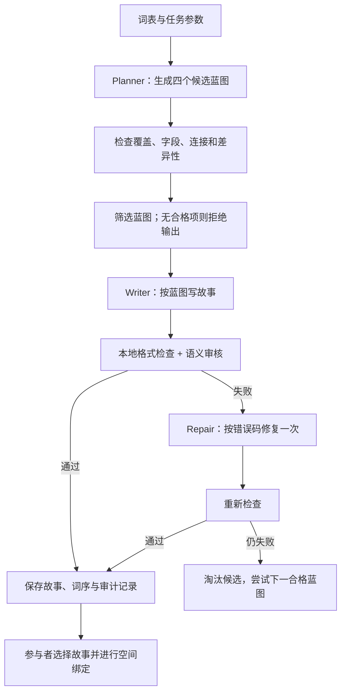

# Story Generator Prompt 设计框架

**项目：LLM Memory Palace｜Prompt 策略：MSF-2.1｜Schema：MSF-2.0｜说明日期：2026-10-22**

本文说明助记故事生成器的设计、输入输出、质量控制与当前验证状态，可独立分享用于科研或技术讨论。

**版本状态：MSF-2.1 的词义优先、独特事件和自然交接策略已适配 Unity 的现有生成流程；完整四蓝图筛选与独立 Audit 仍属于设计资产。三个 JSON Schema 继续使用 MSF-2.0；学习效果尚未经过参与者实验验证。**

## 1. 设计目的

输入一组外语单词及其英文释义，生成一篇简短、连续、容易形成心理画面的英文故事，帮助学习者将词形、词义和事件联系起来。故事随后进入 Memory Palace 流程，由参与者把故事片段分配到空间中的家具锚点。

预期的回忆路径是：

**目标词 → 词义 → 独特动作与可见结果 → 下一事件 → 后续空间绑定**

这是一条待验证的设计假设，不代表已经证明了记忆成绩提升。

## 2. 当前运行版本与新设计的区别

| 项目 | Unity 当前运行版本（MSF-2.1 策略适配） | 完整框架设计（MSF-2.1 模板） |
|---|---|---|
| 单个候选的规划 | 生成 1 个因果蓝图 | 每种叙事风格生成 4 个蓝图后筛选 |
| 核心结构 | 单一目标；每步 `need → action → result`，另有 `goal_link` | 单一目标；每步包含动作、结果、下一需求与视觉签名 |
| 正文长度，默认 8 词 | 约 160–210 词 | 目标为 120–180 词、8–10 句 |
| 目标词标注 | `SpanishWord (EnglishMeaning)` | 同左 |
| 最终输出 | `fullStory` 与简短的 `items` 词序索引 | 增加版本、profile、meaning 和 storySegment |
| 错误处理 | 原有解析检查与最多一次定点修复；结构性 fallback 不再把每个词当成工具 | 计划中的筛选、格式检查、独立语义审核与一次定点修复 |
| 接入状态 | 新策略已接入请求构造；模型参数和实验流程不变 | 完整管线尚未接入 Unity |

下面主要介绍完整框架。蓝图筛选和独立语义质量评分是设计要求；尚未实现完整的自动语义排序系统。当前运行时由 `MnemonicStoryPrompts.cs` 构造请求，并不读取 Docs 模板。

本次优先修改 Prompt，不增加学习效果验证环节，也不改变已有 RQ、实验分组或测量。核心原则是：词义准确优先；词形、释义和事件在同句紧密绑定；每词一个独特线索；事件之间自然交接。目标词需要实质参与事件，但不必都是不可替代的物理工具。

## 3. 输入契约

主要输入是固定词表，例如：

```json
{
  "targets": [
    {"word": "pegamento", "meaning": "glue"},
    {"word": "hambre", "meaning": "hunger"},
    {"word": "olvidar", "meaning": "forget"}
  ],
  "profile": "gentle_mystery",
  "readerLevel": "A2-B1",
  "pointOfView": "second person"
}
```

实际实验通常使用 8 个词；上面仅展示输入字段。模型可以选择适合故事的词序，但不能改变拼写、重音、释义或目标数量。输入可能包含实体、声音、状态、抽象概念和动词，不应一律把目标当成可操作物品。

故事生成阶段不接收参与者已分配的家具、锚点编号或空间路线，避免提前干预空间分配。普通故事场景和目标词本身涉及的物品仍然允许出现。

## 4. 生成流程



### A. Planner：先规划可检查的故事蓝图

Planner 先为每个词选择符合实际词义的事件，再确定一个主目标、一个主要场景和最多一个同伴。每个词对应一个独特的动作、状态、决定或后果，而非只出现在背景里；抽象词和动词无需变成物理道具。

每个 beat 包含：

| 字段 | 作用 |
|---|---|
| `word` / `meaning` | 精确绑定目标词与释义 |
| `role` | 叙事功能，如帮助、阻碍、揭示、验证、解决 |
| `entryCue` | 为什么此刻需要这个词所代表的事物、状态或动作 |
| `action` | 人物如何使用、经历或改变它 |
| `visibleResult` | 发生了什么可以看见或感知的变化 |
| `nextNeed` | 该结果为什么引出下一事件 |
| `imageTag` | 本事件区别于其他事件的视觉签名 |

连接约束为 `beat[i].nextNeed == beat[i+1].entryCue`，最后一项为 `GOAL_RESOLVED`。这使连接字段可机械检查，但**字符串相等不能证明真实因果成立**，还需要语义审核。

Planner 的职责摘要：

```text
Create four distinct story blueprints using every supplied target once.
Ground each exact meaning in one distinctive event before connecting the plot.
Give each target meaningful participation, not compulsory physical indispensability.
For each beat, specify its cue, action, visible result, and next need.
Preserve exact word/meaning strings. Return only the required JSON.
```

### B. 蓝图筛选：先排除格式错误，再判断内容

机械检查包括 JSON/Schema、精确词表覆盖、beat 数量、连接字段、视觉标签重复，以及提前出现 `GOAL_RESOLVED` 等问题。

语义评价沿用六维字段：因果连续性、目标参与度（保留字段名 `targetNecessity`）、可成像性、区分度、可读性、简洁度。旧排序权重 25/20/20/15/10 可以保留为设计参数，但词义/语法错误不能被高分抵消。Audit 模板要求各维 ≥3，且连续性、参与度、可成像性 ≥4 才可通过；这些是未经记忆数据校准的工程门槛，不是当前 Unity 中独立运行的评审器。

内容审核必须额外检查：目标词是否用对、动作中的工具与对象是否混淆、结果是否合理，以及抽象词是否拥有可观察的事件表现。

### C. Writer：把蓝图写成短故事

默认 8 词的写作约束：

- 第二人称 `you`，一条主线，A2–B1 难度作为写作目标。
- 120–180 词、8–10 句；每句最多包含一个目标短语。
- 每个目标精确出现一次，格式为 `SpanishWord (EnglishMeaning)`，后续引用使用代词或英文表达。
- 精确短语与体现词义的事件在同句靠近；必要时将短语作为清楚引入的标签，不允许 `You had to olvidar (forget)` 一类破坏英语语法的插入。
- 每个目标句都包含相关需要、具体动作或状态变化，以及能被理解的结果。
- 最后一拍解决最初的问题；不增加独立支线或让额外道具代替目标词完成主要任务。
- 不输出对白、标题、Markdown、助记方法说明、指定家具锚点或路线指令。

Writer 的职责摘要：

```text
Render the selected blueprint as one continuous second-person micro-story.
Follow its target order. Use each exact target phrase once, one per sentence.
Use concrete actions, visible results, and simple English.
Return only JSON, with each item mapped to its complete target-bearing sentence.
```

### D. Audit：区分词面合规与语义正确

完整框架的本地检查应覆盖词形次数、释义、顺序、items 对齐、完整句子映射和长度。模型审计再先检查实际词义和语法，再判断事件连接、线索区分度和语言自然程度。当前 Unity 只保留原有解析与启发式检查，Writer 的自检指令不等于独立审计，也不能保证语义正确。

审计模型只返回分数、证据和错误码，不负责重写。模型评分是辅助信号，不能代替经过校准的人工盲评，也不能代表记忆效果。

### E. Repair：最多一次定点修复

将失败故事、原蓝图和具体错误交给 Repair，优先修复词义、语法和目标覆盖，只修改必要部分，保留正确词序与有效句子；需要修复事件交接时，只改相邻片段。修复后重新检查；仍失败则淘汰。

典型错误码包括 `TARGET_MISSING`、`TARGET_DUPLICATE`、`MEANING_CHANGED`、`ORDER_MISMATCH`、`BROKEN_CAUSAL_LINK` 和 `WEAK_IMAGE`。

## 5. 候选多样性

设计上为参与者提供三个 profile，每个 profile 内先规划 4 个蓝图，再保留 1 个故事：

| Profile | 故事方向 |
|---|---|
| `collaborative_rescue` | 与同伴共同解决轻度紧迫的日常问题 |
| `hands_on_repair` | 通过修理、搭建或恢复功能形成动作链 |
| `gentle_mystery` | 沿可见线索寻找误放的重要物品 |

这些 profile 是候选多样性策略，不等于项目正式实验的分组条件；其实际使用情况需要记录。

## 6. 输出与 Prompt 组织

完整框架的故事对象结构如下；省略号仅用于字段示意，不是完整合格输出。这里的版本号必须保持 `MSF-2.0`，它是 Schema 兼容值，不是 Prompt 内容版本：

```json
{
  "frameworkVersion": "MSF-2.0",
  "profile": "gentle_mystery",
  "fullStory": "...",
  "items": [
    {
      "word": "pegamento",
      "meaning": "glue",
      "storyOrder": 1,
      "storySegment": "..."
    }
  ]
}
```

每类 Prompt 分成四部分：稳定的 system 指令、本次任务参数、带边界的词表/蓝图数据、输出 JSON Schema。Few-shot 示例单独版本化，与正式词表隔离。数据中的文本不作为模型指令执行。

支持约束解码的后端可使用 Schema 约束；不支持时将 Schema 附在请求里并执行本地验证。仅指定 JSON mode 不能保证字段、覆盖率和语义正确。

为复现结果，记录 Prompt 版本、profile、provider/model、采样参数、词表、蓝图、验证错误、修复次数、最终输出和耗时。设计默认不加入发音双关关键词；如需研究这种记忆路径，应单独定义实验条件。

## 7. 初步验证与已知问题

2026-10-21 使用项目配置的 Claude Haiku 接口做了两组正式词表的离线测试，每组生成 4 个蓝图。

- 混合词组的四蓝图都存在字段长度问题。为查看成文效果，额外选择结构合格但字段超长的蓝图进行诊断渲染，得到 155 词、8 句、目标覆盖 8/8 的故事；这不是严格流程放行结果。
- 实体词组中有 1 个蓝图单独通过结构与字段检查，但整份四蓝图响应仍包含不合格候选。成文首次覆盖 4/8，经过一次修复后达到 8/8，共 161 词、8 句。
- 两组故事仍有词义或物理因果问题，例如把胶水解释成清洁黏土、将“用钥匙打开”修成“用锁打开”。同模型审计漏掉了部分问题。

上述是 2026-10-21 的 MSF-2.0 历史结果，不是 MSF-2.1 的验证结果。它们只表明能够产出候选并暴露失败模式，不足以证明任何版本更优。本次不增加额外参与者实验；编译、兼容性和少量生成检查属于工程验证，不能证明英文含义到西班牙语词形的提取或长期记忆收益。正式研究仍使用原有 Immediate Recall / Delayed Retention 测量。

2026-10-22 的 MSF-2.1 适配已通过完整脚本编译和 56 项兼容检查。一个实际混合词表样本在人工指出语法/衔接错误并调用一次 Repair 后，得到 199 词、8 句、8/8 覆盖；不能将其称为全自动语义审核通过。样本、参数和局限见 `MnemonicStoryPromptV2/VERIFICATION_2026-10-22.md`。

## 8. 模板与参考

完整资产位于项目 `Docs/MnemonicStoryPromptV2/`：包含四类 Prompt 的 system/user 模板、三份 JSON Schema 和独立的 few-shot 示例。

- 模块化生成与示例组织参考：[PAIR Wordcraft](https://github.com/PAIR-code/wordcraft)。
- 词汇助记与空间学习工程参考：[LensWord](https://github.com/conectlens/lensword)、[vocab](https://github.com/AndrewMeleka/vocab)。
- 助记候选过生成与排序参考：[Exploring Automated Keyword Mnemonics Generation with LLMs via Overgenerate-and-Rank](https://arxiv.org/abs/2409.13952)。
- 结构化输出技术参考：[llguidance](https://github.com/guidance-ai/llguidance)。

以上是设计参考，不是本项目学习效果的验证证据。
